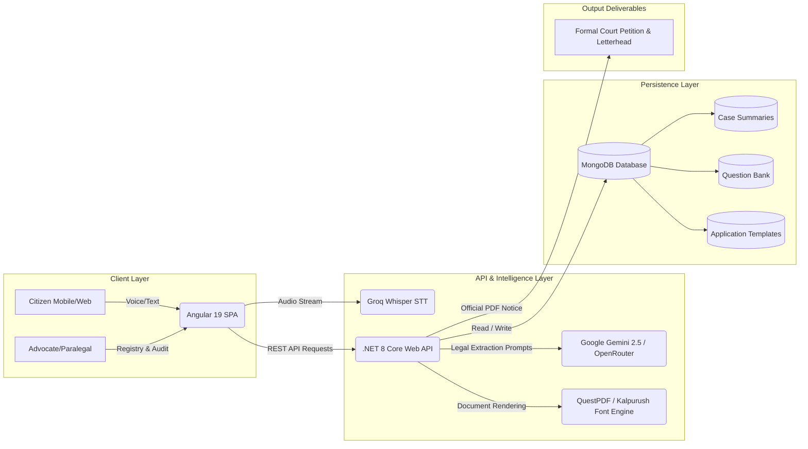

# ⚖️ Odhikar (অধিকার) · AI-Powered Legal Aid & Case Management Platform
### *Empowering Marginalized Communities through Voice-First Legal Intake, Automated Fact Extraction, and Statutory Workflow Automation*

[](https://odhikar-legal-hub.vercel.app)
[](https://odhikar-backend.onrender.com/api)
[](https://odhikar-backend.onrender.com/swagger/index.html)
[](https://github.com/prityd825/Odhikar-with-legal-hub)
[](https://opensource.org/licenses/MIT)

---

## 🌟 Executive Summary

**Odhikar** (*Bengali for "Rights"*) is an end-to-end legal-technology platform designed to democratize access to justice in the Global South, directly contributing to the **United Nations Sustainable Development Goals (UN SDGs)**:
* **SDG 16 (Peace, Justice, and Strong Institutions):** Providing equal, timely access to legal aid for disadvantaged populations.
* **SDG 5 (Gender Equality):** Protecting women from domestic abuse, dowry harassment, and denial of dower/maintenance rights.
* **SDG 10 (Reduced Inequalities):** Eradicating linguistic, literacy, and financial barriers in formal legal processes.

In developing nations like Bangladesh, millions of citizens—particularly rural women, informal workers, and low-income families—are functionally excluded from the justice system due to illiteracy, complex legal jargon, and the exorbitant cost of legal counsel. **Odhikar leverages conversational Large Language Models (LLMs) and Speech-to-Text (STT) technology to convert spoken, unstructured vernacular narratives into legally verified, court-ready petitions while providing legal professionals with an executive audit registry.**

---

## 🚨 The Challenge: The Access-to-Justice Gap

1. **Linguistic & Literacy Barriers:** More than 70% of low-income legal seekers cannot draft written complaints or comprehend legal procedural terminologies.
2. **Fact-Finding Bottlenecks:** Frontline paralegals and legal aid workers manually interview clients, often omitting critical statutory elements (e.g., limitation periods, exact claim amounts, jurisdictional boundaries, evidence documentation).
3. **Caseload Fatigue:** Public defenders and legal aid officers under the **National Legal Aid Services Organization (NLASO)** face overwhelming backlogs, delaying urgent petitions for months.
4. **Safety Blindspots:** Domestic violence and severe threat victims lack automated red-flag detection to trigger immediate escalation and legal protection.

---

## 💡 The Solution: How Odhikar Works

Odhikar introduces a **human-in-the-loop, AI-assisted legal pipeline**:

```
[ Citizen Voice/Text Intake ] 
             ↓
[ Speech-to-Text & Dialect Transcription ] 
             ↓
[ LLM Legal Fact Extraction & Classification ] 
             ↓
[ Statutory Readiness & Audit Checklist Engine ] 
             ↓
[ Executive Table Registry for Paralegals/Lawyers ] 
             ↓
[ 1-Click Court Petition & Formal PDF Generation ]
```

### 1. 🎙️ Voice-First Vernacular Intake
Litigants speak freely in colloquial Bengali without typing. The system transcribes audio, identifies emotional distress markers, and conducts an empathetic dialogue to gather missing facts.

### 2. 🧠 Automated Legal Fact Extraction
Extracts structured legal entities:
* **Parties:** Applicant (বাদী) and Respondent (বিবাদী) details.
* **Financial Facts:** Dower amount (*দেনমোহর*), paid vs. unpaid claims, maintenance arrears (*ভরণপোষণ*), unpaid wages (*বকেয়া মজুরি*).
* **Incident Details:** Marriage date, abuse history, eviction threats, physical harm records.
* **Confidence Scoring:** Tags fields as *High-Confidence (Stated)*, *Inferred*, or *Missing*.

### 3. ⚖️ Judicial Audit & Readiness Scoring
Automatically benchmarks the claim against Bangladeshi statutory criteria, assigning a **Legal Readiness Score (০-১০০%)**:
* Territorial jurisdiction verification (আঞ্চলিক এখতিয়ার).
* Statute of limitations compliance (তামাদি মেয়াদ).
* Evidentiary documentation checklist (কাবিননামা, জিডি কপি, নোটিশ).

### 4. 📄 1-Click Formal Court Petition Drafting
Bridges the gap between raw complaints and formal judicial documents. Generates standard court applications formatted for the Family Court or Labour Court, complete with official letterhead, formal prayer for relief, and downloadable official PDF.

### 5. 🚨 Intelligent Safety Breakout Protocol
Scans testimonies for emergency threat keywords (e.g., severe physical assault, death threats, child abduction). Automatically classifies the case as **Urgent (🚨)** and routes it to emergency helplines (109 / 999) and expedited legal counseling.

---

## 👥 Target Users & Stakeholder Ecosystem

| Stakeholder Persona | Problem Addressed | Platform Value |
| :--- | :--- | :--- |
| **Vulnerable Litigants & Marginalized Citizens** | Cannot afford lawyers or draft petitions; fear formal court settings. | Free, speech-enabled legal triage in their native language with empathetic guidance. |
| **Field Paralegals & Social Workers** | Overburdened by manual note-taking and fragmented documentation. | Fast client onboarding, standardized data collection, and instant clinic appointment booking. |
| **Panel Advocates & Legal Aid Officers** | Waste hours verifying basic facts; manually re-type court petitions. | Executive case registry table, automated audit checklist, and 1-click court application generator. |
| **Legal Aid Organizations (NLASO, BRAC, NGOs)** | Lack centralized digital tracking and operational visibility into pending cases. | Data-driven case queue, triage analytics, and auditable case records. |

---

## 📜 Supported Statutory Legal Frameworks

The platform currently models statutory procedures under primary legislation in Bangladesh:

1. **Family Law & Maintenance:**
   * *Muslim Family Laws Ordinance, 1961 (MFLO)*
   * *Family Courts Act, 2023 (পারিবারিক আদালত আইন, ২০২৩)*
2. **Anti-Dowry & Domestic Violence:**
   * *Dowry Prohibition Act, 2018 (যৌতুক নিরোধ আইন, ২০১৮)*
   * *Domestic Violence (Prevention and Protection) Act, 2010*
3. **Labour Rights & Wages:**
   * *Bangladesh Labour Act, 2006 (Section 33 & Chapter X: Wages and Payment)*
4. **Land Rights & Eviction:**
   * Women''s inheritance rights, marital property claims, and unlawful dispossession.
5. **Women and Child Protection:**
   * Child custody determinations and *Prevention of Women and Children Repression Act, 2000 (Amended 2020)*.

---

## 🌐 Live Deployments & Demonstrations

| Component | Production URL | Description |
| :--- | :--- | :--- |
| 🏠 **Client Web Portal** | [https://odhikar-legal-hub.vercel.app](https://odhikar-legal-hub.vercel.app) | Responsive public landing & feature overview |
| ⚖️ **Citizen AI Legal Intake** | [https://odhikar-legal-hub.vercel.app/intake](https://odhikar-legal-hub.vercel.app/intake) | Multimodal speech-and-text interactive legal consultation |
| 🧑‍⚖️ **Paralegal Registry Desk** | [https://odhikar-legal-hub.vercel.app/paralegal](https://odhikar-legal-hub.vercel.app/paralegal) | Executive case registry table with live search & filters |
| 🔐 **Advocate Demo Login** | [https://odhikar-legal-hub.vercel.app/paralegal/login](https://odhikar-legal-hub.vercel.app/paralegal/login) | Verified Bar Council panel advocate profile portal |
| ⚙️ **Backend Web API** | [https://odhikar-backend.onrender.com/api](https://odhikar-backend.onrender.com/api) | Production .NET 8 RESTful services |
| 📑 **OpenAPI / Swagger** | [https://odhikar-backend.onrender.com/swagger/index.html](https://odhikar-backend.onrender.com/swagger/index.html) | Interactive API documentation & schemas |

---

## 🏗️ Architecture & Data Pipeline



---

## 🛠️ Technology Stack & Engineering Design

### Frontend Application
* **Framework:** Angular 19 (Standalone Components, Signals, Reactive Extensions)
* **Styling & Design System:** Vanilla CSS & Tailwind CSS, custom Glassmorphism components, executive dashboard theme
* **Typography:** Hind Siliguri, Inter, Kalpurush (Bengali Unicode support)
* **Speech Integration:** Web Speech API, Custom Text-to-Speech Engine
* **PDF Compilation:** jsPDF, html2canvas, dynamic client-side DOM rendering
* **Deployment:** Vercel (Edge Network)

### Backend & Cloud Architecture
* **Runtime & Framework:** .NET 8.0 SDK (C# 12)
* **Design Pattern:** Clean Architecture (Domain, Application, Infrastructure, API Layers)
* **Database:** MongoDB (Scalable document store for dynamic legal schemas and templates)
* **AI Orchestration:** Google Gemini 2.5 API, Groq Whisper STT, OpenRouter integration
* **PDF Engine:** QuestPDF with embedded font licensing for high-definition Bengali typography
* **Hosting & CDN:** Render, Cloudflare SSL/TLS

---

## 🛡️ Responsible AI, Guardrails & Ethical Standards

* **Human-in-the-Loop Validation:** AI never files a legal complaint independently. Every auto-generated document requires explicit review, modification, and digital sign-off from a certified advocate.
* **Strict Hallucination Mitigation:** Missing information is explicitly marked as `[তথ্য পাওয়া যায়নি / Not Provided]` rather than synthesized.
* **Privacy & Anonymity:** Client telephone numbers and identifiers are masked during demonstration modes.

---

## 💻 Local Setup & Reproducibility Guide

### Prerequisites
* [.NET 8.0 SDK](https://dotnet.microsoft.com/download/dotnet/8.0)
* [Node.js (v18.x or v20.x)](https://nodejs.org/)
* Angular CLI: `npm install -g @angular/cli`
* MongoDB (Local instance or MongoDB Atlas URI)

### 1. Clone the Monorepo
```bash
git clone https://github.com/prityd825/Odhikar-with-legal-hub.git
cd Odhikar-with-legal-hub
```

### 2. Configure & Run Backend (.NET 8)
```bash
cd backend
dotnet restore
dotnet run --project Odhikar.Api
```
* Backend API will start at: `http://localhost:5000/api`
* Swagger UI documentation: `http://localhost:5000/swagger`

### 3. Configure & Run Frontend (Angular 19)
```bash
cd ../frontend
npm install
npm start
```
* Open your browser and navigate to: `http://localhost:4200`

---

## 📄 License & Disclaimer

* **License:** Distributed under the [MIT License](LICENSE).
* **Legal Disclaimer:** *Odhikar is an assistive technology platform intended to support preliminary legal intake and documentation. It does not replace professional legal representation. All legal drafts must be verified by a licensed advocate prior to submission to any court or statutory authority.*
