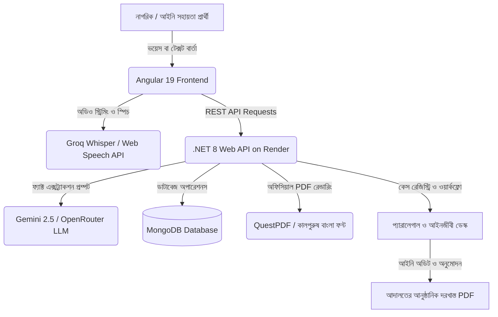

# ⚖️ অধিকার · Odhikar with Legal Hub
### *প্রান্তিক জনগোষ্ঠীর জন্য এআই-চালিত আইনি সহায়তা, ফ্যাক্ট-এক্সট্র্যাকশন ও কেস ম্যানেজমেন্ট প্ল্যাটফর্ম*
### *AI-Assisted Legal Aid, Fact-Finding, and Case Workflow Platform for Bangladesh*

[](https://odhikar-legal-hub.vercel.app)
[](https://odhikar-backend.onrender.com/api)
[](https://odhikar-backend.onrender.com/swagger/index.html)
[](https://github.com/prityd825/Odhikar-with-legal-hub)

---

## 📌 প্রকল্পের সারসংক্ষেপ ও প্রেক্ষাপট (Project Context & Overview)

**অধিকার (Odhikar)** হলো বাংলাদেশের বিচারপ্রার্থী সাধারণ মানুষ এবং লিগ্যাল এইড সংস্থাগুলোর (যেমন: **জাতীয় আইনগত সহায়তা প্রদান সংস্থা - NLASO** ও **বাংলাদেশ বার কাউন্সিল**) মধ্যে দূরত্ব ঘোচানোর জন্য তৈরি একটি আধুনিক **এআই-চালিত আইনি প্রযুক্তি প্ল্যাটফর্ম (Legal-Tech Platform)**।

বাংলাদেশে প্রতি বছর লাখ লাখ মানুষ পারিবারিক কলহ, যৌতুক নির্যাতন, দেনমোহর ও ভরণপোষণ না পাওয়া, বকেয়া মজুরি কিংবা জমিজমা বিরোধের শিকার হন। কিন্তু আইনি প্রক্রিয়ার জটিলতা, সাক্ষরতার অভাব, আদালতের কঠিন পরিভাষা এবং আইনজীবীর উচ্চ ফি-এর কারণে প্রান্তিক জনগোষ্ঠীর একটি বড় অংশ আনুষ্ঠানিক বিচার ব্যবস্থার বাইরে থেকে যায়।

**‘অধিকার’ প্ল্যাটফর্মটি সাধারণ নাগরিকের মুখের সাধারণ ভাষাকে স্বয়ংক্রিয়ভাবে আদালতের গ্রহণযোগ্য আইনি নথিতে রূপান্তর করে এবং প্যারালিগ্যাল ও আইনজীবীদের জন্য একটি পূর্ণাঙ্গ অডিট ড্যাশবোর্ড সরবরাহ করে।**

---

## 🎯 কেন মানুষ এটি ব্যবহার করবে? (Why People Will Use It?)

### ১. মুখে কথা বলে আইনি অভিযোগ নথিভুক্তকরণ (Voice-First Legal Intake)
* সাধারণ নাগরিক বা কম লেখাপড়া জানা মানুষ কোনো টাইপ করা ছাড়াই নিজের আঞ্চলিক ভাষায় বা কথ্য বাংলায় তাদের সমস্যার বিবরণ মুখে বলতে পারেন।
* এআই স্বয়ংক্রিয়ভাবে অডিও শুনে ট্রান্সক্রিপ্ট তৈরি করে এবং ঘটনাটি কোন আইনি বিষয়ের আওতায় পড়ে তা শনাক্ত করে।

### ২. স্বয়ংক্রিয় আইনি তথ্য নিষ্কাশন (Automated Fact Extraction)
* নাগরিকের অগোছালো বর্ণনা থেকে এআই স্বয়ংক্রিয়ভাবে মামলার প্রয়োজনীয় আইনি উপাদানগুলো আলাদা করে ফেলে (যেমন: বাদী ও বিবাদীর নাম, বিবাহের তারিখ, দেনমোহরের অঙ্ক, পরিশোধিত/বকেয়া পরিমাণ, শারীরিক নির্যাতনের বিবরণ, ঘটনার স্থান ও দাবিকৃত প্রতিকার)।

### ৩. জুডিশিয়াল প্রস্তুতি ও অডিট চেকলিস্ট (Legal Readiness & Audit)
* আদালত ও লিগ্যাল এইড ফাইলিং স্ট্যান্ডার্ড অনুযায়ী মামলার আঞ্চলিক এখতিয়ার (Jurisdiction), তামাদি মেয়াদ (Limitation Period), প্রয়োজনীয় সাক্ষ্য-প্রমাণ ও আইনি ধারার শর্ত পূরণ হয়েছে কি না তা স্বয়ংক্রিয়ভাবে অডিট করে স্কোর প্রদর্শন করে।

### ৪. এক ক্লিকে অফিসিয়াল আবেদনপত্র প্রস্তুত (1-Click Court Petition Draft)
* সংগৃহীত তথ্যের ভিত্তিতে আদালতের জন্য নির্ধারিত ফর্ম্যাট অনুযায়ী স্বয়ংক্রিয়ভাবে বাংলা আইনি দরখাস্ত বা লিগ্যাল নোটিশ তৈরি হয়। আইনজীবী যাচাই শেষে তাৎক্ষণিকভাবে প্রিন্ট বা অফিসিয়াল ওয়াটারমার্কযুক্ত PDF ডাউনলোড করতে পারেন।

### ৫. জরুরি নিরাপত্তা ও রেড-ফ্ল্যাগ অ্যালার্ট (Safety & Escalation Protocol)
* গৃহস্থালি সহিংসতা, খুন বা অ্যাসিড নিক্ষেপের মতো তাৎক্ষণিক জীবনের হুমকি থাকলে সিস্টেম স্বয়ংক্রিয়ভাবে কেসটিকে **‘জরুরি (Urgent)’** হিসেবে চিহ্নিত করে সংশ্লিষ্ট জরুরি হেল্পলাইন (১০৯, ৯৯৯) ও প্যারালিগ্যাল টিমের কাছে অগ্রাধিকার ভিত্তিতে পাঠায়।

---

## 👥 কারা এটি ব্যবহার করবে? (Who Will Use It?)

| ব্যবহারকারী গ্রুপ (Target Audience) | প্ল্যাটফর্মের ব্যবহার ও সুবিধা (Role & Value) |
| :--- | :--- |
| **১. প্রান্তিক নাগরিক ও বিচারপ্রার্থী (Citizens / Litigants)** | • দেনমোহর ও ভরণপোষণ বঞ্চিত নারী<br>• যৌতুক ও পারিবারিক নির্যাতনের শিকার নাগরিক<br>• বকেয়া মজুরি বঞ্চিত তৈরি পোশাক ও অপ্রাতিষ্ঠানিক শ্রমিক<br>• ভূমি বা পৈতৃক সম্পত্তি থেকে বেদখল হওয়া ব্যক্তি<br>👉 *সুবিধা: নিজের ভাষায় সরাসরি অভিযোগ জানিয়ে বিনামূল্যে প্রাথমিক আইনি রূপরেখা পান।* |
| **২. মাঠপর্যায়ের প্যারালেগাল ও সমাজকর্মী (Paralegals / Field Workers)** | • ইউনিয়ন বা কমিউনিটি পর্যায়ে নাগরিকদের বক্তব্য গ্রহণ<br>• প্রাথমিক তথ্য যাচাই ও অডিও রেকর্ড পর্যালোচনা<br>• নিকটস্থ লিগ্যাল এইড ক্লিনিকে অ্যাপয়েন্টমেন্ট সময়সূচী (Slot Booking) বরাদ্দ। |
| **৩. প্যানেল আইনজীবী ও লিগ্যাল এইড অফিসার (Panel Lawyers / Advocates)** | • প্যারালেগাল ডেস্কে মামলার রেজিস্ট্রি টেবিল পরিদর্শন<br>• আইনি প্রস্তুতি স্কোর (Legal Readiness Score) পর্যালোচনা<br>• খসড়া ড্রাফট সম্পাদনা, চূড়ান্ত অনুমোদন ও অফিশিয়াল PDF ডাউনলোড। |
| **৪. জাতীয় আইনি সহায়তা সংস্থা (NLASO / NGOs)** | • ডিজিটাল কেস ট্র্যাকিং ও কেন্দ্রীয় রিপোর্ট ব্যবস্থাপনা<br>• মামলা নিষ্পত্তির গতি বৃদ্ধি ও নথি সংরক্ষণে স্বচ্ছতা আনয়ন। |

---

## ⚖️ অন্তর্ভুক্ত প্রধান আইনি বিষয়সমূহ (Covered Legal Domains)

প্ল্যাটফর্মটি বাংলাদেশ সরকারের প্রচলিত মূল আইনগুলোর ওপর ভিত্তি করে পরিচালিত:

1. **দেনমোহর ও ভরণপোষণ (Dower & Maintenance):**
   * *মুসলিম পারিবারিক আইন অধ্যাদেশ, ১৯৬১* এবং *পারিবারিক আদালত আইন, ২০২৩*
2. **যৌতুক ও পারিবারিক সহিংসতা (Dowry & Domestic Violence):**
   * *যৌতুক নিরোধ আইন, ২০১৮* এবং *পারিবারিক সহিংসতা (প্রতিরোধ ও সুরক্ষা) আইন, ২০১০*
3. **বকেয়া মজুরি ও শ্রম বিরোধ (Labour & Unpaid Wages):**
   * *বাংলাদেশ শ্রম আইন, ২০০৬*
4. **জমি ও সম্পত্তি সংক্রান্ত বিরোধ (Land & Property Dispute):**
   * নারীর পৈতৃক ও বৈবাহিক স্বত্ব, বেদখল ও হস্তান্তর সংক্রান্ত বিরোধ
5. **নারী ও শিশু সুরক্ষা (Women & Child Protection):**
   * সন্তানের হেফাজত (Custody) ও *নারী ও শিশু নির্যাতন দমন আইন, ২০০০ (সংশোধিত ২০২০)*

---

## 🔗 লাইভ প্ল্যাটফর্ম লিংকসমূহ (Live Links & Access)

| মডিউল | সরাসরি লিংক | বিবরণ |
| :--- | :--- | :--- |
| 🏠 **মূল ওয়েবসাইট (Landing Page)** | [odhikar-legal-hub.vercel.app](https://odhikar-legal-hub.vercel.app) | সাধারণ নাগরিকদের জন্য প্ল্যাটফর্ম পরিচিতি ও নেভিগেশন |
| ⚖️ **নাগরিক এআই ইনটেক (AI Intake)** | [odhikar-legal-hub.vercel.app/intake](https://odhikar-legal-hub.vercel.app/intake) | নাগরিকের সাথে ভয়েস ও চ্যাটের মাধ্যমে ইন্টারেক্টিভ প্রশ্নোত্তর |
| 🧑‍⚖️ **প্যারালেগাল কেস ডেস্ক (Registry)** | [odhikar-legal-hub.vercel.app/paralegal](https://odhikar-legal-hub.vercel.app/paralegal) | মামলা রেজিস্ট্রি টেবিল, লাইভ সার্চ, অডিট ও ড্রাফটিং ওয়ার্কস্পেস |
| 🔐 **প্যারালেগাল ডেমো লগইন** | [odhikar-legal-hub.vercel.app/paralegal/login](https://odhikar-legal-hub.vercel.app/paralegal/login) | অনুমোদিত আইনজীবী বা প্যারালিগ্যাল প্রোফাইল দিয়ে এক-ক্লিকে লগইন |
| ⚙️ **ব্যাকএন্ড এপিআই (Render)** | [odhikar-backend.onrender.com/api](https://odhikar-backend.onrender.com/api) | হাই-পারফরম্যান্স .NET 8 কোর ওয়েব এপিআই |
| 📑 **ইন্টারেক্টিভ সোয়াগার ডকস** | [odhikar-backend.onrender.com/swagger](https://odhikar-backend.onrender.com/swagger/index.html) | ব্যাকএন্ড এপিআই এন্ডপয়েন্ট ও স্কিমা স্পেসিফিকেশন |

---

## 🏗️ সিস্টেম আর্কিটেকচার (System Architecture)



---

## 🛠️ প্রযুক্তিগত বিবরণ (Tech Stack)

### ক্লায়েন্ট / ফ্রন্টএন্ড (Frontend):
* **Framework:** Angular 19 (Standalone Components, Signals)
* **Styling:** Vanilla CSS, Tailwind CSS, Glassmorphism & Executive Theme
* **Typography:** Hind Siliguri, Inter, Kalpurush
* **Speech Integration:** Web Speech API, Text-to-Speech Engine
* **PDF Export:** jsPDF, html2canvas, Client-side Document Previewer
* **Hosting:** Vercel

### সার্ভার / ব্যাকএন্ড (Backend):
* **Framework:** .NET 8.0 (C# Web API)
* **Architecture:** Clean Architecture (Api, Application, Domain, Infrastructure)
* **Database:** MongoDB (Documents, Case Summaries, Dynamic Application Templates)
* **AI Engines:** Google Gemini API, Groq Whisper STT, OpenRouter
* **PDF Generator:** QuestPDF with embedded Bengali font support
* **Hosting:** Render (Cloudflare CDN Integration)

---

## 💻 লোকাল মেশিনে চালানোর নির্দেশিকা (Local Setup)

### ১. ব্যাকএন্ড চালু করা (.NET 8):
```bash
# ব্যাকএন্ড ফোল্ডারে প্রবেশ করুন
cd backend

# ডিপেনডেন্সি রিস্টোর করুন
dotnet restore

# ব্যাকএন্ড রান করুন
dotnet run --project Odhikar.Api
```
সার্ভার চালু হবে: `http://localhost:5000` (Swagger: `http://localhost:5000/swagger`)

---

### ২. ফ্রন্টএন্ড চালু করা (Angular 19):
```bash
# ফ্রন্টএন্ড ফোল্ডারে প্রবেশ করুন
cd frontend

# প্রয়োজনীয় প্যাকেজ ইনস্টল করুন
npm install

# ডেভেলপমেন্ট সার্ভার রান করুন
npm start
```
ব্রাউজারে ওপেন করুন: `http://localhost:4200`

---

## 📄 লাইসেন্স ও দায়িত্ব অস্বীকার (License & Disclaimer)

* **লাইসেন্স:** এমআইটি লাইসেন্স (MIT License) এর আওতায় উন্মুক্ত।
* **আইনি সতর্কতা:** *এই প্ল্যাটফর্মটি প্রান্তিক জনগোষ্ঠীর প্রাথমিক আইনি সহায়তা ও খসড়া তৈরির একটি সহায়ক প্রযুক্তি মাধ্যম। এটি কোনো বিজ্ঞ আইনজীবীর চূড়ান্ত আইনি পরামর্শের বিকল্প নয়। সংশ্লিষ্ট আদালত বা সরকারি দফতরে দাখিলের পূর্বে অবশ্যই বিজ্ঞ আইনজীবী কর্তৃক নথিপত্র চূড়ান্তভাবে নিরীক্ষিত হওয়া আবশ্যক।*
